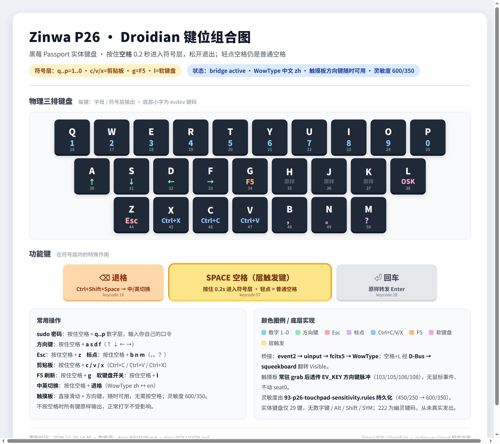

# P26 Passport 输入套件（Droidian）

> 让 Zinwa P26 / 黑莓 Passport 的 29 键硬键盘在 Droidian (Phosh) 上真正可用：
> 无数字键也能输密码、符号层覆盖方向键/Esc/标点/快捷键、触摸板常驻当方向键、
> WowType 中文输入法稳定默认。



## 问题背景

P26 用的是黑莓 Passport 原厂三排键盘：**29 键 = 26 字母 + 退格 + 回车 + 宽空格**，
没有数字键、没有 Alt、没有 Shift、没有独立 SYM 键。在 Phosh 里输 sudo 密码时
软键盘不会自动弹出，几乎无法登录。

尝试用 `keyd` 改键失败：`keyd v2.5.0` 的 `resolve_device_capabilities()` 要求键盘
能力位图里含 `KEY_1..KEY_0`，P26 被静默丢弃，任何 keyd 配置都救不回来。

## 解决方案

用常驻的 **evdev → uinput 桥接** 绕过 keyd：

1. `EVIOCGRAB` 独占抓取物理键盘，避免事件重复；
2. 创建声明了数字键能力的 uinput 虚拟键盘；
3. 普通按键原样转发；
4. **按住空格 0.2 秒**进入符号层，把字母键映射成数字、方向、Esc、标点和快捷键；
5. 轻点空格仍是普通空格，打字完全不受影响。

后续又叠加了两块：触摸板方向键透传（随时可用，需更长滑动触发）和
WowType/fcitx5 输入法加固（开机默认中文、设置窗口 cairo 渲染、中英切换键）。

## 功能一览

| 功能 | 操作 | 输出 |
|---|---|---|
| 数字 | 按住空格 + `q w e r t y u i o p` | `1 2 3 4 5 6 7 8 9 0` |
| 方向键 | 按住空格 + `a s d f` | `↑ ↓ ← →` |
| Esc | 按住空格 + `z` | `Esc` |
| 中文标点 | 按住空格 + `b n m` | `， 。 ？` |
| 复制 / 粘贴 / 剪切 | 按住空格 + `c v x` | `Ctrl+C / Ctrl+V / Ctrl+X` |
| 刷新 | 按住空格 + `g` | `F5` |
| 软键盘开关 | 按住空格 + `l` | 唤出 / 隐藏 squeekboard |
| 中英切换 | 按住空格 + `退格` | WowType `zh` ↔ `en` |
| 触摸板方向键 | 直接滑动触摸板（无需按空格） | `↑ ↓ ← →` |

## 仓库结构

```
p26-passport-input-kit/
├── README.md                         本文件
├── LICENSE                           MIT
├── docs/
│   ├── SOLUTION.md                   完整解决过程与方案（问题 → 根因 → 实现 → 验证）
│   ├── KEYMAP.md                     键位映射与符合层速查
│   └── TROUBLESHOOTING.md            排障记录、勘误与被否决方案
├── scripts/
│   ├── p26-digit-bridge.py           核心桥接守护进程（当前生效版）
│   └── p26-bridge-selftest.py        设备端自测（10 项）
├── config/
│   ├── p26-digit-bridge.service      systemd 单元（与 keyd 冲突）
│   ├── 91-p26-touchpad-off.rules     设备原有触摸板屏蔽规则（未改动，供复现）
│   ├── 93-p26-touchpad-sensitivity.rules  触摸板灵敏度持久化
│   ├── fcitx5-autostart.sh           开机自动切 WowType（带回读校验）
│   └── io.github.Gloridust.WowType.Config.desktop   cairo 渲染的设置窗口
└── assets/
    ├── P26-键位组合图.png
    └── P26-键位组合图.html
```

## 快速开始

在 P26（Droidian 101 / aarch64）上：

```sh
# 1. 停用 keyd（两者不能共存）
sudo systemctl disable --now keyd

# 2. 安装桥接
sudo install -m 755 scripts/p26-digit-bridge.py /usr/local/bin/p26-digit-bridge.py
sudo install -m 644 config/p26-digit-bridge.service /etc/systemd/system/p26-digit-bridge.service
sudo systemctl daemon-reload
sudo systemctl enable --now p26-digit-bridge

# 3.（可选）触摸板方向键灵敏度：默认 450/250，数值越大越不灵敏
sudo install -m 644 config/93-p26-touchpad-sensitivity.rules /etc/udev/rules.d/
sudo udevadm control --reload-rules

# 4.（可选）输入法加固：按 docs/SOLUTION.md 第 5 节配置 fcitx5 / WowType
```

验证：

```sh
systemctl is-active p26-digit-bridge     # active
python3 scripts/p26-bridge-selftest.py   # 全部 PASS
```

## 文档

- [完整方案与解决过程](docs/SOLUTION.md) — 从硬件事实、keyd 失败根因到桥接实现与验证
- [键位映射速查](docs/KEYMAP.md) — 所有按键、组合与状态
- [排障与勘误](docs/TROUBLESHOOTING.md) — 走过的弯路、被否决的鼠标方案、关键坑

## 注意

- 本项目不记录任何真实口令；涉及 sudo 的地方请填入你自己的密码。
- udev 规则与脚本路径按 P26 实测环境（Droidian 101）编写，其他设备请先核对
  `/dev/input/` 下的设备名与 sysfs 节点路径。
- 桥接以 root 运行并独占抓取键盘；出问题可 `sudo systemctl stop p26-digit-bridge`
  立即恢复原始输入。
