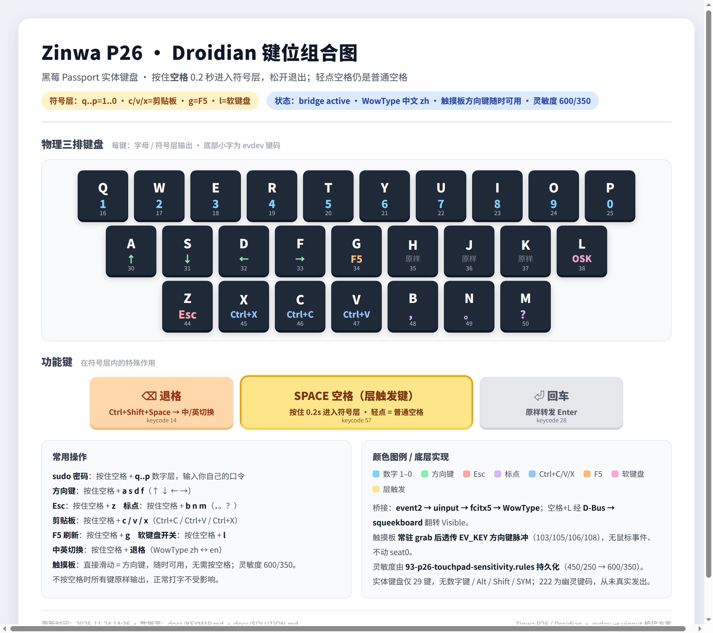

# 键位映射速查

触发方式：**按住空格超过 0.20 秒**进入符号层，松开退出；日志里表现为 `digit layer ON / OFF`。
轻点空格（低于阈值）在 release 时补发普通空格。

## 物理键盘

P26 / 黑莓 Passport 三排 29 键：26 字母 + 退格 + 回车 + 宽空格。无数字键、Alt、Shift、独立 SYM。

| 排 | 按键 | evdev 键码 |
|---|---|---|
| 第一排 | `q w e r t y u i o p` | 16-25 |
| 第二排 | `a s d f g h j k l` | 30-38 |
| 第三排 | `z x c v b n m` | 44-50 |
| 功能键 | 退格 / 回车 / 空格 | 14 / 28 / 57 |

## 符号层映射（按住空格）

| 物理键 | evdev | 注入 | 用途 |
|---|---:|---|---|
| `q` | 16 | KEY_1 (2) | 1 |
| `w` | 17 | KEY_2 (3) | 2 |
| `e` | 18 | KEY_3 (4) | 3 |
| `r` | 19 | KEY_4 (5) | 4 |
| `t` | 20 | KEY_5 (6) | 5 |
| `y` | 21 | KEY_6 (7) | 6 |
| `u` | 22 | KEY_7 (8) | 7 |
| `i` | 23 | KEY_8 (9) | 8 |
| `o` | 24 | KEY_9 (10) | 9 |
| `p` | 25 | KEY_0 (11) | 0 |
| `a` | 30 | KEY_UP (103) | ↑ |
| `s` | 31 | KEY_DOWN (108) | ↓ |
| `d` | 32 | KEY_LEFT (105) | ← |
| `f` | 33 | KEY_RIGHT (106) | → |
| `z` | 44 | KEY_ESC (1) | Esc |
| `b` | 48 | KEY_COMMA (51) | `，` |
| `n` | 49 | KEY_DOT (52) | `。` |
| `m` | 50 | Shift(42) + Slash(53) | `？` |
| `退格` | 14 | Ctrl(29)+Shift(42)+Space(57) | WowType 中/英切换 |
| `c` | 46 | Ctrl(29)+KEY_C(46) | 复制 |
| `v` | 47 | Ctrl(29)+KEY_V(47) | 粘贴 |
| `x` | 45 | Ctrl(29)+KEY_X(45) | 剪切 |
| `g` | 34 | KEY_F5 (63) | F5 |
| `l` | 38 | 动作型 | 唤出 / 隐藏软键盘 |

> 注意：`x/c/v` 的 evdev 键码分别是 45/46/47，映射表中物理键 `x` 对应 45。

## 触摸板（无需按空格）

| 操作 | 事件 | 用途 |
|---|---|---|
| 滑动触摸板 | EV_KEY 103/105/106/108 原样转发 | `↑ ↓ ← →`，随时可用 |

灵敏度：sysfs `key_x_threshold` / `key_y_threshold`，默认 450/250，本项目设为 **600/350**
（越大越不灵敏）。由 `config/93-p26-touchpad-sensitivity.rules` 持久化。

## 组合键实现细节

- `emit_seq()`：press 正序，release 逆序，修饰键最后松开。
- 动作型键（软键盘开关）只在 value=1 时触发一次，松键不重复。
- 未进入符号层时所有按键原样转发（含退格与回车）。
- 触摸板事件不断唤醒时，空格长按超时仍按显式 `now >= deadline` 判断，符号层不会失效。
